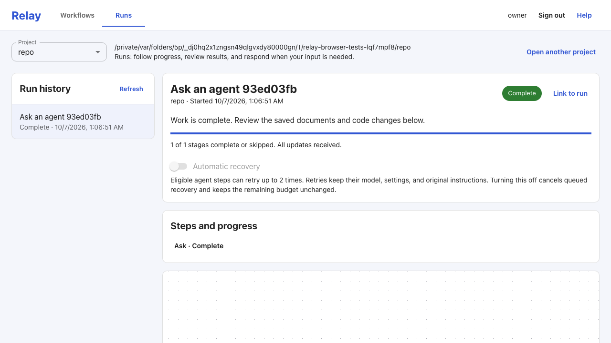

# Relay

[](https://pypi.org/project/relay-app/)
[](https://pypi.org/project/relay-app/)
[](https://github.com/viseshrp/relay/actions/workflows/main.yml)
[](https://codecov.io/gh/viseshrp/relay)
[](https://github.com/viseshrp/relay/blob/main/LICENSE)
[](https://docs.astral.sh/ruff/formatter/)
[](https://docs.astral.sh/ruff/)
[](https://docs.astral.sh/ty/)

Relay is a local web app for building and running multi-step coding-agent
workflows on your own machine. Instead of manually copying prompts and files
between terminal sessions, you can chain planning, coding, testing, review, and
approval steps into a visual workflow that runs safely in an isolated Git
worktree.



## Why use Relay?

- **Use the coding agents you already have**: Run Claude Code, Codex, GitHub
  Copilot CLI, Cursor CLI, or Antigravity side by side in the same workflow.
- **Keep your working branch safe**: Every workflow runs in an isolated Git
  worktree. Your active branch is never modified unless you choose to merge a
  completed run.
- **Start from templates, edit visually or in YAML**: Pick one of seven built-in
  starter workflows, then customize steps on an interactive canvas or in a
  GitHub Actions-style YAML editor.
- **Stay in control of long runs**: Watch live logs and diffs, approve or deny
  permission requests, pause before the next step, or retry a failed step with
  a different model without losing completed work.

## Quick start

### 1. Check prerequisites

You need:

- **Python 3.10 to 3.14** and **Git** on macOS, Linux, or Windows
- **At least one supported coding agent** installed and signed in:
  - Claude Code
  - OpenAI Codex
  - GitHub Copilot CLI
  - Cursor CLI
  - Antigravity

Don't worry if you haven't configured an agent yet—Relay's setup screen shows
install links and sign-in commands for each one.

### 2. Install and start Relay

Install Relay and launch it inside any Git repository:

```bash
pip install relay-app
cd /path/to/your/git-repo
relay up
```

Relay creates a `.relay/` folder in your repository and opens the web app in
your browser at `http://127.0.0.1:7845/`.

Prefer not to use a local password on your machine? Start with:

```bash
relay up --no-login
```

### 3. Run your first workflow in the browser

1. **Finish first-time setup**: Create your local password (unless you used
   `--no-login`) and check that at least one coding agent shows as ready.
2. **Pick a starter template**: Select **Start from a template**:
   - **New to Relay?** Choose **Ask an agent** for a fast, read-only first run
     using a single agent.
   - **Ready for a full coding task?** Keep the preselected **AI coding
     workflow** (which plans, implements, tests, and reviews changes across
     multiple steps).
3. **Launch and watch**: Enter your task description, select your model(s), and
   click **Run workflow**. Watch live step output, respond to any approval
   prompts, and inspect the resulting Git diff and artifacts when it finishes.

## Other ways to install

Isolated CLI tools (`pipx` or `uv`):

```bash
pipx install relay-app
# or
uv tool install relay-app
```

Docker (`linux/amd64` and `linux/arm64` images on GHCR): the image contains
Relay only. Coding-agent CLIs and their sign-ins are not included, so agent
steps cannot run inside it. From a Relay checkout, serve your repository with
the published image:

```bash
make docker-up DOCKER_IMAGE=ghcr.io/viseshrp/relay:latest \
  DOCKER_WORKTREE=/path/to/your/git-repo
```

Without `DOCKER_IMAGE`, `make docker-up` builds the image from the checkout.
See [Container images](docs/packaging.md#container-images) for release tags,
nightly tags, and `make` targets.

The installed browser app runs without Node.js. Opt-in local JavaScript actions
require an installed Node 20 or 24 runtime matching their metadata.
Contributors who build the frontend from source need a Node version supported
by Vite; see [CONTRIBUTING.md](CONTRIBUTING.md).

## Key concepts for new users

### Starter templates and workflow files

Relay includes seven [starter workflows](docs/workflows.md#starter-workflows)
that copy into your repository's `.relay/workflows/` folder when you select
one. Workflows use the [Actions jobs and steps dialect](docs/workflows.md),
including serial matrices, local reusable workflows and actions, scoped
secrets, environment approvals, caches, artifacts, and opt-in local triggers.
If you know GitHub Actions, see
[Coming from GitHub Actions](docs/coming-from-github-actions.md) for a side-by-side
comparison and three runnable examples.

### Safe Git isolation and clean launch

Relay captures your saved workflow and prompt files at launch—you do not need
to commit `.relay/` files before running a workflow. Untouched initialization
files and supported generated planning or review documents may stay untracked,
while staged changes or unrelated edits in your working tree block launch so
you never accidentally mix uncommitted work with a run. See
[Clean launch](docs/git-and-artifacts.md#clean-launch).

Each job shares one isolated worktree across its ordered steps and commits
accepted changes at the job boundary. By default, run branches stay separate
from your working branch. To fast-forward your active branch automatically when
every job succeeds, select **Merge into the active branch, then delete working
copies** in **Settings** or **Run workflow**. See
[Run integration](docs/git-and-artifacts.md#opt-in-run-integration).

### Recovery, retries, and live controls

- **Pause between steps**: Click **Pause new steps** to let the current step
  finish while holding the next stage. While paused, you can change an
  unstarted agent's model or settings and then resume without losing completed
  work. See
  [Pause new steps](docs/execution.md#pause-new-steps-and-change-an-unstarted-agent).
- **Retry with another model**: If an agent step stops, you can retry that step
  with a different installed agent or exact model while keeping earlier steps,
  prompts, and snapshots intact. See
  [Failure and recovery](docs/execution.md#failure-cancellation-and-recovery).
- **Automatic step recovery**: Opt-in
  [automatic recovery](docs/execution.md#automatic-step-recovery) retries
  eligible agent failures up to twice with the same model, retained reports,
  and a separate repair instruction.
- **Quota reset resume**: When a provider reports a structured usage reset
  time, Relay can automatically resume the paused stage once the quota resets.
  See [Provider usage resets](docs/execution.md#provider-usage-resets).

## Documentation guides

| Topic | Guide |
| --- | --- |
| First run and browser tour | [Getting started](docs/getting-started.md) |
| GitHub Actions syntax comparison | [Coming from GitHub Actions](docs/coming-from-github-actions.md) |
| Workflow YAML, starters, and prompts | [Workflows](docs/workflows.md) and [Language compatibility](docs/workflow-language-compatibility.md) |
| Visual editor, runs view, and login modes | [Web UI](docs/web-ui.md) |
| Coding agents, models, and permissions | [Agents](docs/agents.md) |
| Execution lifecycle, retries, and controls | [Execution](docs/execution.md) |
| Git cleanliness, worktrees, and artifacts | [Git and artifacts](docs/git-and-artifacts.md) |
| Settings, storage paths, and backups | [Projects and storage](docs/projects-and-storage.md) |
| Packaging and container images | [Packaging](docs/packaging.md) |

## Administration and CLI reference

Most day-to-day work—authoring workflows, launching runs, answering approval
prompts, inspecting logs/artifacts, and retrying steps—happens in the browser.
Open **Settings** in the browser to configure default agents, models, thinking
effort, shared commands, environment variables, recovery, and cleanup across
projects. See the
[settings inventory](docs/projects-and-storage.md#global-defaults-and-project-overrides)
and [Open without a login](docs/web-ui.md#open-without-a-login).

The `relay` CLI handles local setup, health checks, and storage cleanup:

<!-- [[[cog
import cog
from click.testing import CliRunner

from relay.cli import main

commands = (
    (["--help"], "$ relay --help"),
    (["data", "clean", "--help"], "$ relay data clean --help"),
)
for index, (arguments, prompt) in enumerate(commands):
    result = CliRunner().invoke(main, arguments, prog_name="relay")
    if result.exit_code != 0:
        raise RuntimeError(result.output) from result.exception
    if index:
        cog.outl()
    cog.outl("```console")
    cog.outl(prompt)
    cog.out(result.output)
    cog.outl("```")
]]] -->
```console
$ relay --help
Usage: relay [OPTIONS] COMMAND [ARGS]...

  Run Relay setup and local administration commands.

  Workflow authoring and run control are available in the browser started by
  `relay up`.

Options:
  -v, --version  Show the version and exit.
  --json         Keep the existing machine-readable output.
  -h, --help     Show this message and exit.

Commands:
  data     Inspect or delete retained local Relay data.
  doctor   Check local storage, assets, Git, and coding-agent readiness.
  init     Create a blank .relay project surface in the current Git...
  project  Inspect or relink registered projects.
  up       Start the loopback web application and local worker.
```

```console
$ relay data clean --help
Usage: relay data clean [OPTIONS]

  Delete confirmed local run data and retained Git state.

Options:
  --json       Keep the existing machine-readable output.
  --runs       Delete run records, snapshots, and artifacts.
  --worktrees  Remove preserved run worktrees.
  --branches   Delete retained run and attempt refs.
  --all        Select every category, including logs.
  -h, --help   Show this message and exit.
```
<!-- [[[end]]] -->

### Checking setup with `relay doctor`

`relay doctor` checks Git, local SQLite storage, packaged frontend assets, and
all five supported coding agents. It succeeds when core checks pass and at
least one agent is ready (missing optional agents are still listed); a failed
core check or zero ready agents returns exit code `6`. It also checks working
tree cleanliness for untouched starter files and exempt root reports.

### Machine-readable CLI output

Administration commands print human-readable text by default. Pass `--json`
(for example, `relay doctor --json`, `relay project list --json`,
`relay project relink OLD_PATH NEW_PATH --json`, `relay data clean --json`, or
`relay --json COMMAND`) for sorted JSON output and structured error envelopes.
`relay init` and `relay up` always use text output.

## Privacy and safety

Relay binds to loopback (`127.0.0.1` / `localhost`), sends no product
telemetry, and keeps run history on your machine until you delete it. Agent and
command subprocesses inherit the local worker environment. Declared workflow
secrets and `add-mask` values are redacted from public run output, while
arbitrary inherited environment variables and retained files are not
automatically redacted. Agent sign-in and credentials stay with your installed
agent CLIs. See
[Variables, secrets, and environments](docs/workflows.md#variables-secrets-and-environments).

## Architecture and project status

Relay stores authoritative state in SQLite (`relay.db`) and runs eligible steps
through a single Huey worker thread. Django and Uvicorn serve the HTTP API and
replayable server-sent events; React Flow and CodeMirror power the browser
editor. Coding agents connect over the Agent Client Protocol (ACP), except for
Antigravity's native headless interface. Portable workflow files live in
`.relay/`, while databases, logs, artifacts, and worktrees live in standard
per-user OS application directories.

Relay Phase 1 is local, single-owner, and implemented ahead of its first
tagged release:

- **macOS arm64**: All five supported agents passed authenticated
  writer-workflow certification on 2026-10-03.
- **Windows**: Codex ACP completed a live workflow on 2026-10-14; Claude Code,
  Copilot CLI, and Cursor CLI passed Windows Actions diagnostics on 2026-10-15.
- **Remaining live verification**: Antigravity on Windows and live provider
  execution on Linux. Exact versions, model selectors, artifact hashes, and
  cleanup records live in [`certification/`](certification/README.md).

## Development

See [CONTRIBUTING.md](CONTRIBUTING.md) for Python and frontend setup, focused
test commands, and packaging checks. The [Relay TODO list](docs/todo.md) tracks
the agent configuration checklist.

## Changelog

See [CHANGELOG.md](CHANGELOG.md).

## License

MIT © [Visesh Prasad](https://github.com/viseshrp)
